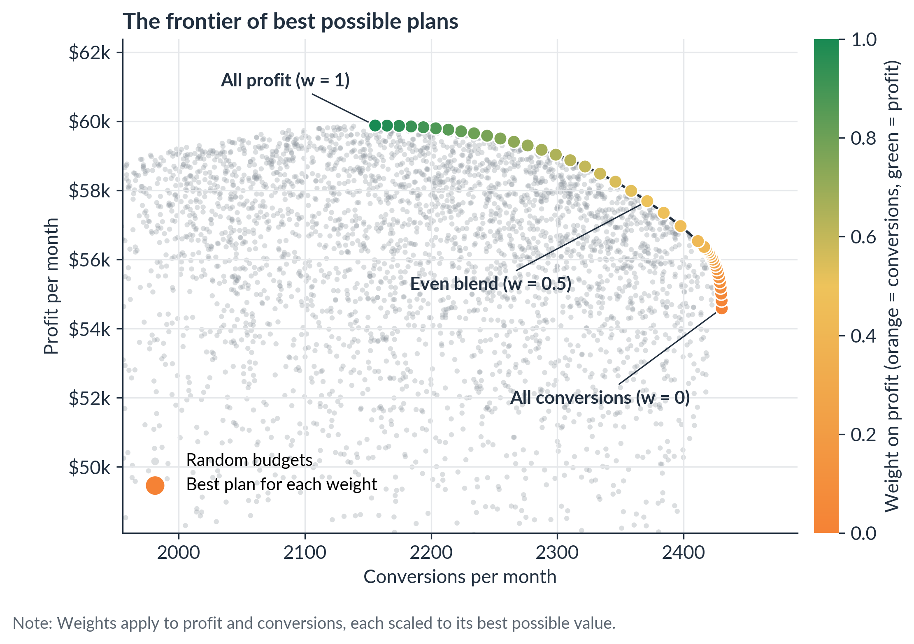

# Objective Functions for Marketers

## NOTE - Still under development ##

[](https://colab.research.google.com/github/joedom99/objective-functions-for-marketers/blob/main/objective_functions_for_marketers.ipynb)


[](LICENSE)

Companion notebook for the Marketing Data Science article **"Objective Functions for Marketers: How Models Decide What 'Best' Means."**



## What This Is

Every optimization problem, from an ad platform's bidding algorithm to a media mix model to a budget meeting, is trying to make some number as large or as small as possible. That number is the objective function, and it's how a model decides what "best" means. Change it, and the same channels, budget, and optimizer produce a different "best" plan.

This notebook works through one marketing budget problem in four steps:

1. **Same channels, different objectives.** The optimal budget across Search, Social, and Display changes depending on whether you maximize conversions, revenue, or profit.
2. **Constraints change the answer, and they cost something.** Holding the objective at maximum profit, a CPA target, a ROAS target, and a channel commitment each move the plan and carry an opportunity cost.
3. **Blending goals into a utility function.** A weighted utility of profit and conversions traces a Pareto frontier of best possible plans.
4. **Which objective fits your business?** A guide to matching the objective to the business situation, plus a margin sensitivity check and the difference between choosing the wrong objective and measuring the right one poorly.

It closes with a brief note on loss functions and a validation cell that checks every plan against its rules.

Everything is simulated with illustrative assumptions, not client data. The response curves are assumptions, not estimates from real campaigns. A fixed random seed keeps results reproducible, and they should match mine closely, though the last digit can differ slightly across library versions.

Settings live in a few labeled cells: `P` (channels and budget), `R` (business rules), and `U` (utility sweep). Numbers quoted in the notebook text describe the default settings.

## What's Inside

| Section | What it shows |
|---|---|
| 1. Setup | Libraries, brand styling, and a helper that saves tables as images |
| 2. The anatomy of an optimization problem | Decision variables, objective function, and constraints, plus utility for multiple goals |
| 3. Part 1: Same channels, different objectives | Max conversions, revenue, and profit produce three different budgets |
| 4. Part 2: Constraints change the answer | Opportunity cost and shadow price of each business rule, holding the profit objective constant |
| 5. Part 3: Blending goals into a utility function | A weighted utility, the Pareto frontier, and a dominance check |
| 6. Part 4: Which objective fits your business? | Business situations matched to objectives, margin sensitivity, and measurement risk |
| 7. A brief note on loss functions | How objectives work inside models that learn from data |
| 8. Checking the results | All 56 generated plans checked against their budget and rules |
| 9. Summary | Key numbers and takeaways |

### Repository structure

```
objective-functions-for-marketers/
├── objective_functions_for_marketers.ipynb   # The notebook
├── figures/                                  # Six figures generated by the notebook (300 dpi)
│   ├── fig01_one_channel_two_objectives.png
│   ├── fig02_channel_response_curves.png
│   ├── fig03_budget_by_objective.png
│   ├── fig04_budget_by_constraint.png
│   ├── fig05_cost_of_constraints.png
│   └── fig06_utility_frontier.png
├── tables/                                   # Six table images (300 dpi), each with a CSV text copy
│   ├── table01_objective_anatomy.png
│   ├── table02_objective_outcomes.png
│   ├── table03_constraint_costs.png
│   ├── table04_utility_weights.png
│   ├── table05_which_objective_fits.png
│   └── table06_margin_sensitivity.png
├── requirements.txt
├── LICENSE
└── README.md
```

### How to run it

The easiest way is to click the **Open in Colab** badge above. NumPy, pandas, Matplotlib, and SciPy are preinstalled in Google Colab, so there's nothing to install. Run all cells from top to bottom. It takes a minute or two.

To run it locally, you'll need Python 3.10 or later and Jupyter:

```bash
git clone https://github.com/joedom99/objective-functions-for-marketers.git
cd objective-functions-for-marketers
pip install -r requirements.txt notebook
jupyter notebook objective_functions_for_marketers.ipynb
```

The notebook downloads the Lato font for its figures and falls back to the default font if it can't.

## Key Results

With the default assumptions. Profit here means contribution profit after advertising: revenue times gross margin, minus ad spend.

- **One curve, two answers.** On its own, Search earns the most profit at about $21,700 a month, while revenue keeps rising all the way to the $60,000 budget.
- **Three objectives, three budgets.** Maximizing conversions or revenue spends the full $60,000. Maximizing profit spends $45,025, leaves about $15,000 unspent, and earns $59,875 in profit versus $54,587 for max conversions.
- **Constraints have very different costs.** Holding the objective at maximum profit, a $20 CPA target gives up $148 a month, a 5.5 ROAS target gives up $372, and a $25,000 Display commitment gives up $4,853. At a $25,000 minimum, each extra required dollar on Display costs about $0.67 in profit (its shadow price).
- **The weights are the decision.** Blending profit and conversions traces a frontier from 2,430 conversions and $54,587 profit to 2,156 conversions and $59,875 profit. An even blend lands at 2,371 conversions and $57,687 profit. None of 4,000 random budgets beats the frontier on both measures.
- **Assumptions matter too.** The max-profit budget rises from $37,234 at a 35% margin to $53,943 at 60%.

## Related Articles

- [The Cobra Effect: When Marketing Metrics Bite Back](https://blog.marketingdatascience.ai/the-cobra-effect-when-marketing-metrics-bite-back-d4ac686c1b8d)
- [Marketing Mix Modeling with Robyn: How to Build Your First MMM Step-by-Step](https://blog.marketingdatascience.ai/marketing-mix-modeling-with-robyn-how-to-build-your-first-mmm-step-by-step-6ddf95d01094)
- [Is It Worth It? How to Run a Cost-Benefit Analysis for Better Marketing Decisions](https://blog.marketingdatascience.ai/is-it-worth-it-how-to-run-a-cost-benefit-analysis-for-better-marketing-decisions-5a8dd38216e2)
- [A Marketer's Guide to Calculus](https://blog.marketingdatascience.ai/a-marketers-guide-to-calculus-9ced95758447)
- [Weighted Average Cost of Marketing (WACM): A Risk-Adjusted Hurdle Rate for Smarter Marketing Investments](https://blog.marketingdatascience.ai/weighted-average-cost-of-marketing-wacm-a-risk-adjusted-hurdle-rate-for-smarter-marketing-948b05e45186)
- [Robyn: An Analyst's Guide to MMM](https://facebookexperimental.github.io/Robyn/docs/analysts-guide-to-MMM)

## License

This project is licensed under the MIT License. See [LICENSE](LICENSE) for details.

## Author

**Joe Domaleski** | Founder, [Country Fried Creative](https://countryfriedcreative.com) | [blog.marketingdatascience.ai](https://blog.marketingdatascience.ai)
